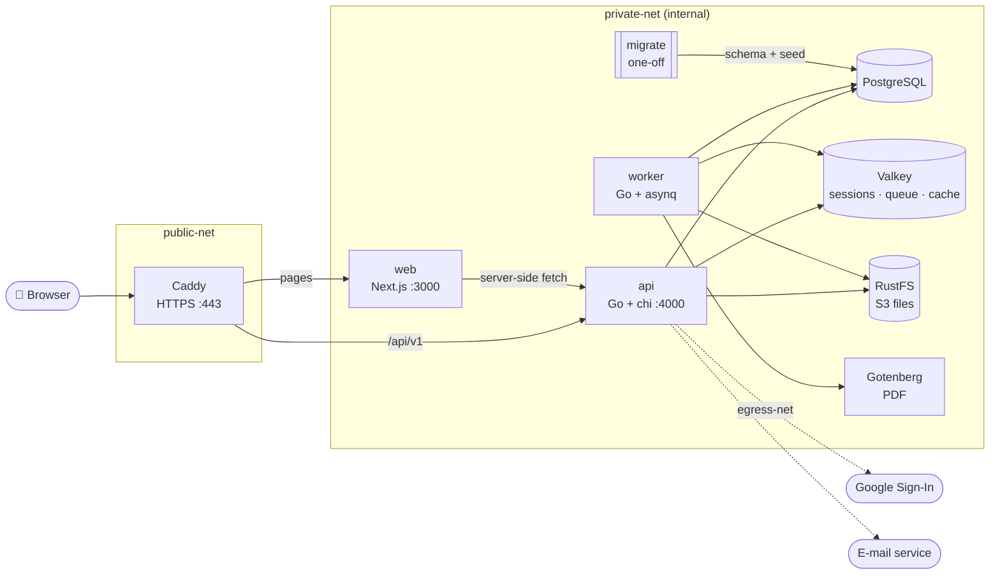
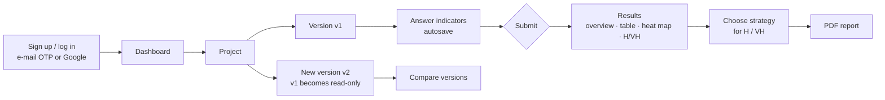
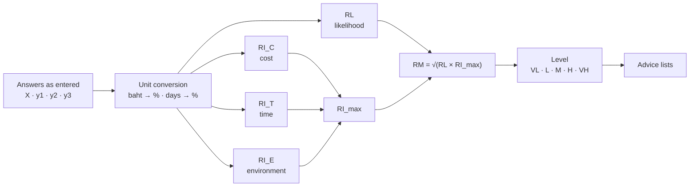
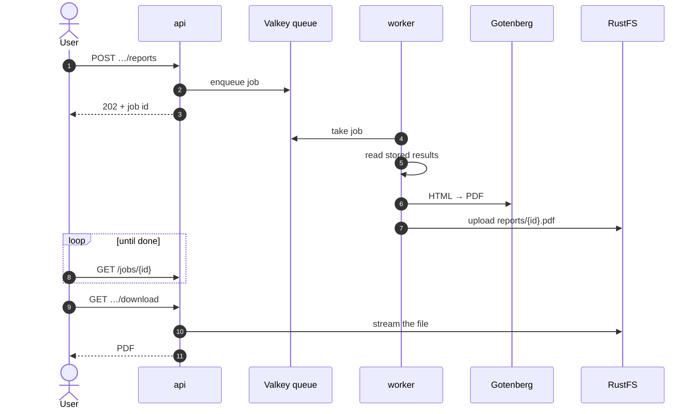

<div align="center">

# 🏝️ CRE · Construction Risk Expert

**Assess construction risk for island projects: answer 55 indicators, get scores, risk levels, advice and a PDF report.**

[](https://github.com/suppakorn-tae/cre-website/actions/workflows/ci.yml)
[](https://github.com/suppakorn-tae/cre-website/actions/workflows/ci-e2e.yml)


[Quick start](#-quick-start) · [Commands](#-commands) · [Architecture](#-architecture) · [Standards](#-standards) · [Repo layout](#-repo-layout) · [Docs](#-docs)

</div>

---

## ✨ Features

| | |
| --- | --- |
| 🔐 **Accounts** | Sign up by e-mail (OTP) or Google, log in, reset password, delete account |
| 📁 **Projects** | Projects with versions; older versions become read-only |
| 📝 **Assessment** | 55 indicators with unit pickers, autosave and server-side validation |
| 📊 **Results** | Stored scores and levels, heat map, H/VH advice and strategy choice |
| 📈 **Dashboard** | KPI cards, level distribution, version compare and RM trends |
| 📄 **Reports** | PDF reports rendered in the background, ready to download |
| 🛠️ **Admin** | Users, RL thresholds, impact tables, advice lists, audit log, pseudonymised research export |

The interface is in Thai.

---

## 🚀 Quick start

> **You need:** Docker with Compose, Go (see `backend/go.mod`), and Node from `.nvmrc` with corepack.

```sh
# 1. install
corepack enable
corepack pnpm install --frozen-lockfile

# 2. configure (then set SESSION_SECRET in the file, e.g. `openssl rand -hex 32`)
cp deploy/compose/.env.example deploy/compose/.env

# 3. run
make up
```

Open **<https://localhost>**. Caddy uses its own local CA, so accept the browser warning.
Check health with `curl -k https://localhost/api/v1/healthz`, stop with `make down`.

> [!NOTE]
> The api will not start without `SESSION_SECRET` (32+ bytes). Leave `GOOGLE_CLIENT_ID` and `GOOGLE_CLIENT_SECRET` empty locally; Google sign-in then answers 503. Never commit `.env`.

<details>
<summary><b>👤 Get a local admin account</b> (dev only)</summary>

<br>

There is no admin sign-up. Sign up as a normal user, then promote the account. **Never do this on a real deployment.**

1. Sign up at <https://localhost> as, for example, `admin@example.com`.
2. Read the OTP from Mailpit (not published on the host, so ask from inside the network). It is in the `Subject` of the newest message:

   ```sh
   docker compose -f deploy/compose/compose.yaml exec caddy \
     wget -qO- http://mailpit:8025/api/v1/messages
   ```

3. Promote the account:

   ```sh
   docker compose -f deploy/compose/compose.yaml exec -T db psql -U cre_owner -d cre \
     -c "UPDATE account SET role = 'admin' WHERE email = 'admin@example.com'"
   ```

Change the user and database names if you changed `POSTGRES_USER` / `POSTGRES_DB`. The e2e suite does the same in `e2e/global-setup.ts`.

</details>

<details>
<summary><b>🎨 Work on the web only, with mocks</b></summary>

<br>

No backend needed. The browser answers every API call from `web/src/mocks`:

```sh
NEXT_PUBLIC_API_MOCKS=1 corepack pnpm --dir web dev
```

Then open <http://localhost:3000>. You are signed in as a sample user; the server uses the mock session too, so no api container is needed.

To open the admin area, start with the admin role (an admin can open every other page as well):

```sh
NEXT_PUBLIC_API_MOCKS=1 CRE_MOCK_ROLE=admin corepack pnpm --dir web dev
```

Then open <http://localhost:3000/admin/users>. Mock mode skips the sign-in check, so a production build or server refuses to start with `NEXT_PUBLIC_API_MOCKS=1`. To check every page in mock mode, run `corepack pnpm --dir e2e test:mock`.

</details>

---

## 🧰 Commands

Run from the repo root.

| Command | What it does |
| --- | --- |
| `make up` / `make down` | Start or stop the stack |
| `make gen` | Regenerate the OpenAPI bundle, Go server, sqlc code, TypeScript types and MSW worker |
| `make lint` | Spectral, golangci-lint, ESLint and the i18n check |
| `make test` | Backend and web tests (testcontainers, so Docker must run) |
| `make test-backend` / `make test-web` | One side only |
| `make build` | Build backend and web |

> [!IMPORTANT]
> Run `make gen lint test` before you push. Generated code is committed, and CI fails when it is stale.

<details>
<summary><b>🧪 End-to-end tests</b> (Playwright)</summary>

<br>

The suite runs on its own stack with throw-away secrets (`e2e/compose.env`). It also uses ports 80 and 443, so stop the dev stack first.

```sh
corepack pnpm --dir e2e exec playwright install chromium
corepack pnpm --dir e2e run stack:up
corepack pnpm --dir e2e test
corepack pnpm --dir e2e run stack:down
```

CI runs it nightly and on pull requests that touch `e2e/` ([`ci-e2e.yml`](.github/workflows/ci-e2e.yml)).

</details>

<details>
<summary><b>⚡ Load test</b> (k6)</summary>

<br>

Needs only Docker. It builds its own stack with two api replicas and seeds 500 users × 10 projects × 5 versions.

```sh
loadtest/run.sh up     # build, start and seed
loadtest/run.sh test   # run k6, 3 min by default (DURATION=1m to shorten)
loadtest/run.sh down   # stop and clean up
```

Latest numbers: every interactive endpoint is under 1 s at p95. See [`loadtest/RESULTS.md`](loadtest/RESULTS.md).

</details>

---

## 🏗️ Architecture

Everything runs in Docker Compose. Only Caddy is published (ports 80 and 443).



<details>
<summary><b>🗺️ Full architecture diagram</b> (v2.3)</summary>

<br>

[](docs/specs/architecture/cre-architecture-v2.3.png)

Source: [`cre-architecture-v2.3.drawio`](docs/specs/architecture/cre-architecture-v2.3.drawio). Decisions: [`cre-architecture-decisions.md`](docs/specs/architecture/cre-architecture-decisions.md).

</details>

### How a user goes through it



### How a score is made

On submit, the api scores every complete indicator with the version's snapshot of thresholds and stores the result. Results are **never recalculated on read**.



Full method: [risk engine spec](docs/specs/risk-engine/cre-risk-engine-and-indicators-v1.1.pdf).

### How a PDF report is built



Research exports work the same way, as a ZIP with no e-mails, and expire after 7 days.

| Part | Technology |
| --- | --- |
| Backend | Go, chi, oapi-codegen, pgx + sqlc, asynq |
| Web | Next.js, TypeScript, next-intl, TanStack Query, MSW |
| Data | PostgreSQL 16, Valkey, RustFS (S3) |
| Other | Gotenberg (PDF), Caddy (proxy and TLS) |

Exact versions live in `backend/go.mod`, `.nvmrc` and `package.json`.

---

## 📏 Standards

What the project follows and what the repo shows. Spec IDs are in the [requirements](docs/specs/requirements/cre-requirements-usecase.tex) (PDF next to it).

| Area | Standard | Status | Proof |
| --- | --- | --- | --- |
| Accessibility | WCAG 2.2 AA | Partial: audited Nov 2026, axe gate in CI; open: 2.4.11, 2.5.8, 1.4.10; no screen reader pass | [audit](docs/a11y/audit-2026-11.md) · [contrast](docs/a11y/contrast-2026-11.md) · [axe helper](e2e/helpers/a11y.ts) · [CI job `e2e-mock`](.github/workflows/ci-e2e.yml) |
| Privacy | Thai PDPA | Partial: privacy by design (pseudonymised export, account deletion, notice at sign-up); no legal review in the repo | NFR-03, BR-14, UC-18 · [export test](backend/internal/service/export/export_integration_test.go) · [deletion test](backend/internal/http/handler/account/handler_integration_test.go) · [deleted accounts in backups](docs/runbooks/restore.md#deleted-accounts) |
| Passwords | Argon2id, OWASP minimum profile (19 MiB, 2 passes) | Met | NFR-02 · [`register_crypto.go`](backend/internal/service/auth/register_crypto.go) |
| API contract | OpenAPI 3.1, Spectral lint, contract tests | Met: handler tests validate responses against the spec; stale generated code fails CI | [`openapi.yaml`](contracts/openapi/openapi.yaml) · [contract helper](backend/internal/testutil/contract/contract.go) · [`ci.yml`](.github/workflows/ci.yml) |
| Commits | Conventional Commits 1.0 | Met: commitlint and PR title check are required checks | [`commitlint.config.js`](commitlint.config.js) · [`pr-lint.yml`](.github/workflows/pr-lint.yml) · [CONTRIBUTING.md](CONTRIBUTING.md#commits) |
| Transport | HTTPS only, TLS from Caddy | Met | NFR-01 · [`Caddyfile`](deploy/compose/Caddyfile) · [`Caddyfile.prod`](deploy/compose/Caddyfile.prod) |
| Security headers | HSTS, nosniff, referrer policy | Partial: no CSP or frame header set, HSTS has no `includeSubDomains` | [`Caddyfile.prod`](deploy/compose/Caddyfile.prod) |
| Application security | OWASP Top 10 / ASVS | Not claimed: no audit or security test cites them | Gap |
| Performance | p95 under 1 s for interactive requests | Met at 100 virtual users, 2 api replicas, 2 vCPU host | NFR-04 · [`loadtest/RESULTS.md`](loadtest/RESULTS.md) |
| Backups | RPO 5 min, RTO 4 h | Partial: targets, procedure and automatic restore check exist when `BACKUP_ENABLED=true`; no recorded drill | [architecture decisions](docs/specs/architecture/cre-architecture-decisions.md#backup-and-recovery-optional) · [restore runbook](docs/runbooks/restore.md) · [`restore-check.sh`](deploy/backup/restore-check.sh) |

---

## 📂 Repo layout

```text
backend/     Go: cmd/ (api, worker, migrate), internal/ (http, service, engine, dal, worker), migrations/, seed/
web/         Next.js app, Thai catalogue in messages/th/, MSW mocks in src/mocks/
contracts/   OpenAPI contract and codegen config
deploy/      Compose files (compose/) and backups (backup/)
e2e/         Playwright tests and their stack
loadtest/    k6 scripts, seed data and runner
docs/        Specs (specs/) and runbooks (runbooks/)
```

---

## 📚 Docs

| | |
| --- | --- |
| 📐 [Specs](docs/specs/README.md) | Requirements, risk engine, architecture, database, UX/UI. **The source of truth.** |
| 🧩 Diagrams | [Use cases](docs/specs/requirements/cre-usecase-diagram.pdf) · [User flow](docs/specs/user-flow/cre-userflow.drawio) · [ER overview](docs/specs/database/figures/er-overview.pdf) · [Wireframes](docs/specs/ux-ui/CRE-wireframes.drawio) · [Hi-fi UI](docs/specs/ux-ui/CRE-hifi-ui.drawio) (open `.drawio` files at [app.diagrams.net](https://app.diagrams.net)) |
| 🚢 [Deploy runbook](docs/runbooks/deploy.md) | Production deploy, including [Google sign-in setup](docs/runbooks/deploy.md#google-sign-in) |
| 💾 [Restore runbook](docs/runbooks/restore.md) | Backups and restore |
| 🤝 [CONTRIBUTING.md](CONTRIBUTING.md) | Branches, commits, pull requests, required checks |
| 🤖 [AGENTS.md](AGENTS.md) | Rules for coding agents |
