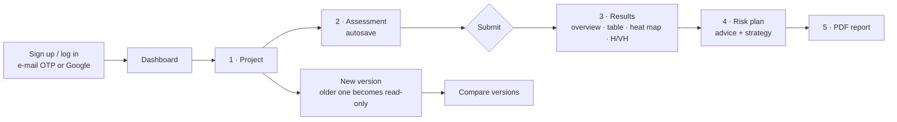
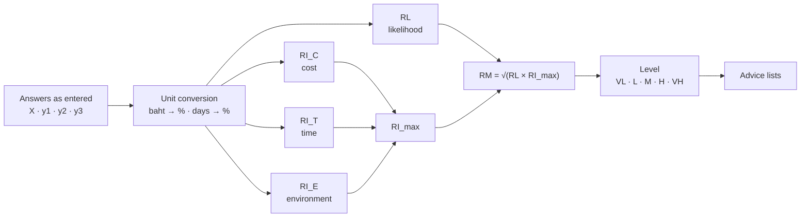
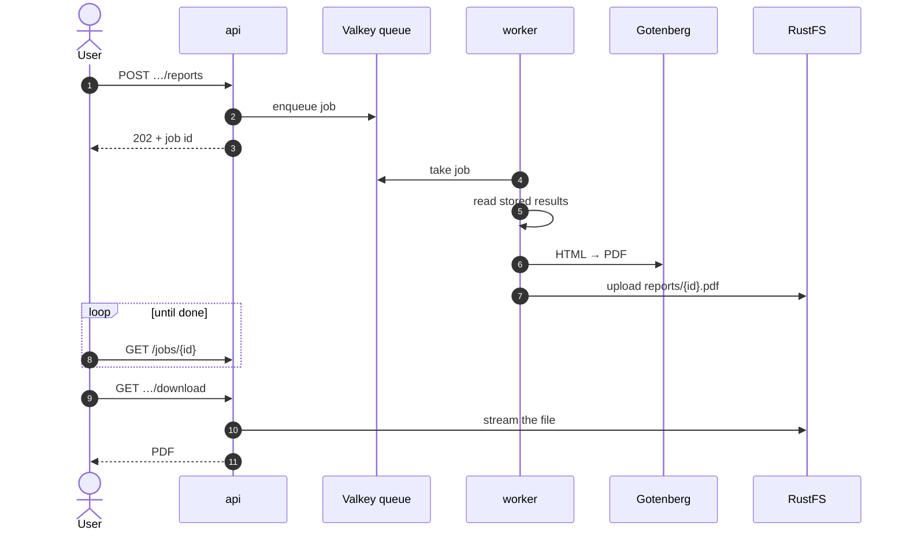
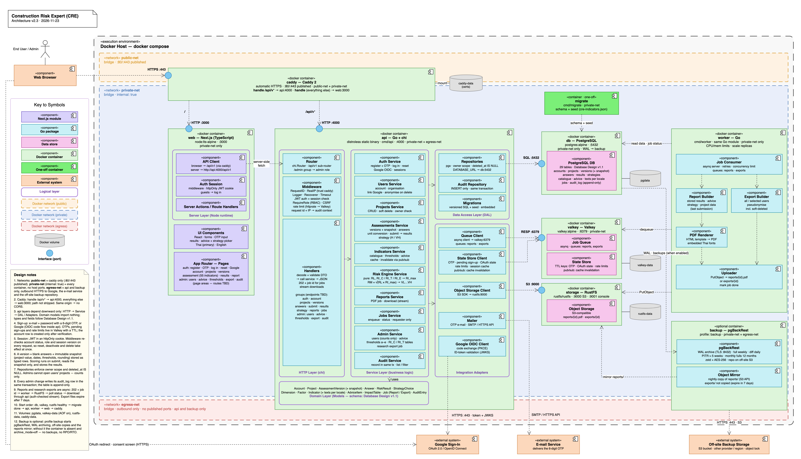

<div align="center">

<picture>
  <source media="(prefers-color-scheme: dark)" srcset="docs/brand/cre-logo-full-dark.png">
  
</picture>

### Construction risk assessment for projects on Thai islands

Answer 55 indicators, then get scores, risk levels, expert advice, a risk plan and a PDF report.

[](https://github.com/suppakorn-tae/cre-website/actions/workflows/ci.yml)
[](https://github.com/suppakorn-tae/cre-website/actions/workflows/ci-e2e.yml)
[](docs/a11y/audit-2026-11.md)
[](contracts/openapi/openapi.yaml)
[](CONTRIBUTING.md#commits)
<br>


[**Features**](#-features) · [**Quick start**](#-quick-start) · [**Standards**](#-standards) · [Architecture](#%EF%B8%8F-architecture) · [Commands](#-commands) · [Docs](#-docs)

</div>

<br>

| 📋 55 indicators | 🎯 5 risk levels | 🧭 5-step flow | 🌗 Light and dark | 🇹🇭 Thai UI, ready for more languages |
| :---: | :---: | :---: | :---: | :---: |

---

## ✨ Features

### For assessors

| | Feature | What you get |
| :---: | --- | --- |
| 🔐 | **Accounts** | Sign up with e-mail and a one-time code, or with Google. Reset your password or delete your account yourself. |
| 📁 | **Projects and versions** | Island, type, value, dates and progress for each project. Each new version starts blank; older versions become read-only. |
| 📝 | **Assessment** | 55 indicators in 3 dimensions and 11 factors, with unit pickers (baht or %, days or %), a question shown on focus, autosave and server-side validation. |
| 📊 | **Results** | Scores stored when you submit, never recalculated: an overview, a detail table, a heat map and an H/VH summary. |
| 🧭 | **Risk plan** | Expert advice for every H and VH indicator, and a strategy for each: reduce, transfer, avoid or accept. |
| 📄 | **PDF report** | Built in the background. It downloads by itself when ready, with a letterhead and running headers. |
| 📈 | **Dashboard and compare** | KPI cards, level distribution, H/VH per project, and version-to-version trends and RM per indicator. |

### For administrators

| | Feature | What you get |
| :---: | --- | --- |
| 👥 | **Users** | Search, change roles, deactivate and delete (anonymise). Admins see project and version counts only, never another user's data. |
| ⚖️ | **Thresholds** | RL thresholds (a–e) per indicator, and the shared RI<sub>C</sub> / RI<sub>T</sub> tables side by side. Changes apply to new versions only. |
| 💡 | **Advice** | One to five advice items per list (RL, RI<sub>C</sub>, RI<sub>T</sub>, RI<sub>E</sub>) for each indicator. |
| 🔬 | **Research export** | Pseudonymised ZIP (no e-mails), built in the background. It expires after 7 days. |
| 🧾 | **Audit log** | Every admin action with old and new values, written in the same transaction and append-only in the database. |

### Built in

| | |
| :---: | --- |
| ♿ | **Accessible**: WCAG 2.2 AA, checked by axe on every page in CI, plus a keyboard and colour-contrast audit (see [Standards](#-standards)). |
| 🌗 | **Light and dark themes**: follows the system theme or your choice, and contrast is checked for both. |
| 📱 | **Responsive**: from 320 px phones to desktop. Tables turn into cards on small screens. |
| 🌐 | **Ready for more languages**: every string comes from a message catalogue, and dates use the Buddhist era in Thai. |

---

## 🚀 Quick start

> [!TIP]
> **Only working on the UI?** Skip Docker. Run `corepack pnpm install` and then `NEXT_PUBLIC_API_MOCKS=1 corepack pnpm --dir web dev`, and open <http://localhost:3000>. You are signed in as a sample user. Add `CRE_MOCK_ROLE=admin` for the admin area.

**Full stack.** You need Docker with Compose, Go 1.27, and Node 24 (see `.nvmrc`) with corepack.

```sh
# 1. Install
corepack enable
corepack pnpm install --frozen-lockfile

# 2. Configure, then set SESSION_SECRET in the file (e.g. openssl rand -hex 32)
cp deploy/compose/.env.example deploy/compose/.env

# 3. Run
make up
```

Then open **<https://localhost>**. Caddy uses its own local CA, so accept the browser warning once.

| Check | Command |
| --- | --- |
| Is it up? | `curl -k https://localhost/api/v1/healthz` |
| Read the e-mails (OTP codes) | Mailpit, see the [dev runbook](docs/runbooks/dev.md#a-full-stack) |
| Stop it | `make down` |

> [!NOTE]
> The api will not start without `SESSION_SECRET` (32 bytes or more). Never commit `.env`. If `db` keeps restarting after a pull (PostgreSQL 19 does not read older data), see [Reset the database](docs/runbooks/dev.md#reset-the-database).

<details>
<summary><b>Other ways to run it</b></summary>

<br>

| Way | Use it for | Docker | Guide |
| --- | --- | :---: | --- |
| A. Full stack | Everything, as users see it | ✅ | [dev.md#a](docs/runbooks/dev.md#a-full-stack) |
| B. Web only with mocks | UI work | — | [dev.md#b](docs/runbooks/dev.md#b-web-only-with-mocks) |
| C. Backend on the host | Debugging Go | infra only | [dev.md#c](docs/runbooks/dev.md#c-backend-on-the-host) |
| D. End-to-end tests | Playwright, with the real api or with mocks | D1 ✅ · D2 — | [dev.md#d](docs/runbooks/dev.md#d-end-to-end-tests) |
| E. Load test | k6 performance runs | ✅ | [dev.md#e](docs/runbooks/dev.md#e-load-test) |

A local admin account and troubleshooting are in the [dev runbook](docs/runbooks/dev.md). Production is in the [deploy runbook](docs/runbooks/deploy.md).

</details>

---

## 📏 Standards

What the project follows, and where to check it. **Status:** ✅ Met · 🟡 Partial · 🗓️ Planned · ⛔ Not claimed.

### ♿ Accessibility

| Standard | Status | Proof |
| --- | :---: | --- |
| [](https://www.w3.org/TR/WCAG22/) <br>Automated and keyboard audit | ✅ | Every page passes axe at 375 and 1280 px, and CI fails on any violation. A manual pass covered keyboard, focus order and visibility, focus not obscured, target size, reflow at 320 px, text spacing, reduced motion and status messages. · [audit](docs/a11y/audit-2026-11.md) · [axe helper](e2e/helpers/a11y.ts) · [CI job `e2e-mock`](.github/workflows/ci-e2e.yml) |
|  <br>Colour contrast, light and dark | ✅ | All 142 token pairs pass (text 4.5:1, non-text 3:1). A unit test and a Playwright check gate every change. · [contrast report](docs/a11y/contrast-2026-11.md) · [`contrast-pairs.ts`](web/src/lib/contrast-pairs.ts) |
|  <br>Motion | ✅ | Every animation duration drops to 0 ms under `prefers-reduced-motion`. · [`tokens.css`](web/src/styles/tokens.css) |
|  <br>Screen reader verification | 🗓️ | Planned: a hands-on pass of the assessment and results pages, and a check that status messages are spoken. Names, roles and live regions are already in place (WCAG 4.1.2, 4.1.3 pass). · [audit, last row](docs/a11y/audit-2026-11.md) |

### 🔒 Security and privacy

| Standard | Status | Proof |
| --- | :---: | --- |
|  <br>TLS from Caddy | ✅ | NFR-01 · [`Caddyfile`](deploy/compose/Caddyfile) · [`Caddyfile.prod`](deploy/compose/Caddyfile.prod) |
|  <br>OWASP minimum profile (19 MiB, 2 passes) | ✅ | NFR-02 · [`register_crypto.go`](backend/internal/service/auth/register_crypto.go) |
|  <br>Privacy by design | 🟡 | Pseudonymised export, account deletion and a notice at sign-up. No legal review in the repo. · NFR-03, BR-14, UC-18 · [pseudonymisation test](backend/internal/worker/export/export_integration_test.go) · [deletion test](backend/internal/http/handler/account/handler_integration_test.go) · [deleted accounts in backups](docs/runbooks/restore.md#deleted-accounts) |
|  <br>HTTP security headers | ✅ | Nonce-based CSP on every page and deny-all on the api, HSTS with `includeSubDomains`, `X-Frame-Options`, `nosniff`, referrer and permissions policies. A shell test checks the Caddyfiles and every e2e spec fails on a CSP violation. · [`Caddyfile.prod`](deploy/compose/Caddyfile.prod) · [`proxy.ts`](web/src/proxy.ts) · [`caddyfile_test.sh`](deploy/test/caddyfile_test.sh) · [`security-headers.spec.ts`](e2e/tests/meta/security-headers.spec.ts) |
|  <br>OWASP Top 10, mapped | ✅ | Each of the ten 2025 categories maps to code, tests and ASVS rows, with what is left. · [`owasp-top-10.md`](docs/security/owasp-top-10.md) |
|  <br>OWASP ASVS Level 1 | 🟡 | 70 rows: 51 pass (3 by review), 16 not applicable, 3 fail with open issues ([IO-269](https://linear.app/printf-scanf/issue/IO-269) cookie prefixes, [IO-270](https://linear.app/printf-scanf/issue/IO-270) common passwords, [IO-271](https://linear.app/printf-scanf/issue/IO-271) SMTP STARTTLS). · [`asvs-l1.md`](docs/security/asvs-l1.md) · [policies](docs/security/policies.md) |
|  <br>Go security scans | ✅ | `gosec` runs in golangci-lint and `govulncheck` fails the required `backend` job on a reachable vulnerability. · [`ci.yml`](.github/workflows/ci.yml) · [`.golangci.yml`](backend/.golangci.yml) |
|  <br>DAST: OWASP ZAP baseline | ✅ | Passive ZAP baseline scan of the public and signed-in pages, plus the api scan on the OpenAPI contract, against the e2e stack. The `zap` job fails on any medium or high alert. · [`e2e/zap`](e2e/zap/scan.sh) · [`ci-e2e.yml`](.github/workflows/ci-e2e.yml) |
|  <br>OWASP ASVS Level 2 | 🗓️ | Planned after the Level 1 fails are closed. |

### 🧱 Engineering

| Standard | Status | Proof |
| --- | :---: | --- |
| [](contracts/openapi/openapi.yaml) <br>Contract first | ✅ | Spectral lint. Handler tests check responses against the spec, and stale generated code fails CI. · [contract helper](backend/internal/testutil/contract/contract.go) · [`ci.yml`](.github/workflows/ci.yml) |
| [](https://www.conventionalcommits.org/) <br>Commit and PR titles | ✅ | commitlint and the PR title check are required. · [`commitlint.config.js`](commitlint.config.js) · [`pr-lint.yml`](.github/workflows/pr-lint.yml) |
| [](loadtest/RESULTS.md) <br>Interactive requests | ✅ | Met at 100 virtual users, 2 api replicas, on a 2 vCPU host. · NFR-04 · [`loadtest/RESULTS.md`](loadtest/RESULTS.md) |
|  <br>Recovery targets | 🟡 | The procedure and an automatic restore check exist when `BACKUP_ENABLED=true`. No recorded drill yet. · [architecture decisions](docs/specs/architecture/cre-architecture-decisions.md#backup-and-recovery-optional) · [restore runbook](docs/runbooks/restore.md) · [`restore-check.sh`](deploy/backup/restore-check.sh) |

Spec IDs (NFR, BR, UC) are in the [requirements](docs/specs/requirements/cre-requirements-usecase.tex), with the PDF next to it.

---

## 🏗️ Architecture

Everything runs in Docker Compose. Only Caddy is published (ports 80 and 443).


| Part | Technology |
| --- | --- |
| Backend | Go, chi, oapi-codegen, pgx + sqlc, asynq |
| Web | Next.js, TypeScript, Tailwind CSS, Radix UI, next-intl, TanStack Query, MSW |
| Data | PostgreSQL 19, Valkey, RustFS (S3) |
| Other | Gotenberg (PDF), Caddy (proxy and TLS) |

Exact versions live in `backend/go.mod`, `.nvmrc` and `package.json`.

<details>
<summary><b>🧭 How a user goes through it</b></summary>

<br>



</details>

<details>
<summary><b>🧮 How a score is made</b></summary>

<br>

On submit, the api scores every complete indicator with the version's snapshot of thresholds and stores the result. Results are **never recalculated on read**.



Full method: [risk engine spec](docs/specs/risk-engine/cre-risk-engine-and-indicators-v1.1.pdf).

</details>

<details>
<summary><b>📄 How a PDF report is built</b></summary>

<br>



Research exports work the same way, as a ZIP with no e-mails.

</details>

<details>
<summary><b>🗺️ Full architecture diagram (v2.3)</b></summary>

<br>

[](docs/specs/architecture/cre-architecture-v2.3.png)

Source: [`cre-architecture-v2.3.drawio`](docs/specs/architecture/cre-architecture-v2.3.drawio). Decisions: [`cre-architecture-decisions.md`](docs/specs/architecture/cre-architecture-decisions.md).

</details>

---

## 🧰 Commands

Run from the repo root.

| Command | What it does |
| --- | --- |
| `make up` / `make down` | Start or stop the stack |
| `make gen` | Regenerate the OpenAPI bundle, Go server, sqlc code, TypeScript types and MSW worker |
| `make lint` | Spectral, golangci-lint, ESLint and the i18n check |
| `make test` | Backend and web tests (testcontainers, so Docker must be running) |
| `make test-backend` / `make test-web` | One side only |
| `make build` | Build backend and web |

> [!IMPORTANT]
> Run `make gen lint test` before you push. Generated code is committed, and CI fails when it is stale.

End-to-end tests (Playwright) and the load test (k6) are in the [dev runbook](docs/runbooks/dev.md#d-end-to-end-tests). CI runs e2e nightly and on pull requests that touch `e2e/`. The latest load test numbers are in [`loadtest/RESULTS.md`](loadtest/RESULTS.md).

---

## 📂 Repo layout

```text
backend/     Go: cmd/ (api, worker, migrate), internal/ (http, service, engine, dal, worker), migrations/, seed/
web/         Next.js app, Thai catalogue in messages/th/, MSW mocks in src/mocks/
contracts/   OpenAPI contract and codegen config
deploy/      Compose files (compose/) and backups (backup/)
e2e/         Playwright tests and their stack
loadtest/    k6 scripts, seed data and runner
docs/        Specs, runbooks, accessibility reports (a11y/) and brand assets (brand/)
```

Every folder, what it does and where new code goes: [**docs/repo-structure.md**](docs/repo-structure.md).

---

## 📚 Docs

| | |
| :---: | --- |
| 📐 | [**Specs**](docs/specs/README.md): requirements, risk engine, architecture, database, UX/UI. **The source of truth.** |
| 🧩 | **Diagrams**: [use cases](docs/specs/requirements/cre-usecase-diagram.pdf) · [user flow](docs/specs/user-flow/cre-userflow.drawio) · [ER overview](docs/specs/database/figures/er-overview.pdf) · [wireframes](docs/specs/ux-ui/CRE-wireframes.drawio) · [hi-fi UI](docs/specs/ux-ui/CRE-hifi-ui.drawio). Open the `.drawio` files at [app.diagrams.net](https://app.diagrams.net). |
| ♿ | [**Accessibility**](docs/a11y/audit-2026-11.md): WCAG 2.2 AA audit and the [contrast report](docs/a11y/contrast-2026-11.md) |
| 💻 | [**Dev runbook**](docs/runbooks/dev.md): five ways to run the app, a local admin account and troubleshooting |
| 🚢 | [**Deploy runbook**](docs/runbooks/deploy.md): production deploy, including [Google sign-in setup](docs/runbooks/deploy.md#google-sign-in) |
| 💾 | [**Restore runbook**](docs/runbooks/restore.md): backups and restore |
| 🗂️ | [**Repo structure**](docs/repo-structure.md): what each folder does and where new code goes |
| 🎨 | [**Brand**](docs/brand/README.md): logo, mark and app icons |
| 🤝 | [**CONTRIBUTING.md**](CONTRIBUTING.md): branches, commits, pull requests and required checks |
| 🤖 | [**AGENTS.md**](AGENTS.md): rules for coding agents |

<div align="center">
<br>
<sub>Construction Risk Expert · assess · analyze · control</sub>
</div>
