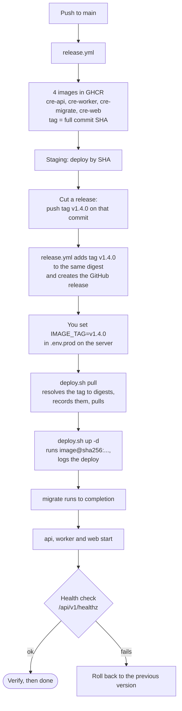

# Deploy runbook: production (conriskexpert.com)

Spec: Architecture v2.3 with decisions v2.14 (Stack, Networking, Backup and
recovery, Kubernetes-readiness 1 and 6; v2.13 fixed the domain, Brevo and the
S3-compatible backup repository).
Files: `deploy/compose/compose.prod.yaml`, `deploy/compose/Caddyfile.prod`,
`deploy/compose/env.prod.example`, `.github/workflows/release.yml`.
Running on your own machine instead? See [dev.md](dev.md).

## How a deploy flows

Images are built by CI and pulled by the server. Production never builds on the server.
A person starts every deploy; nothing deploys by itself.



Images: `ghcr.io/<owner>/<repo>/cre-api`, `cre-worker`, `cre-migrate`, `cre-web`.
`IMAGE_REGISTRY` is `ghcr.io/<owner>/<repo>`.

- Every push to `main` builds all four, tagged by the full commit SHA.
- A release is a SemVer git tag (`v1.4.0`). Its run adds the version tag
  to the images of that commit, so the version and the SHA name the same
  digest (if the commit has no images yet, one build pushes both tags).
  It also creates a GitHub release with notes generated from the merged
  PRs since the previous tag.
- Production deploys a version; staging may deploy a SHA. `IMAGE_TAG`
  takes either. `deploy.sh` refuses `latest`, branch names and short SHAs.
- A tag in GHCR can be moved; a digest cannot. `deploy.sh pull` resolves
  `IMAGE_TAG` to each image's digest and writes them to `.env.digests`;
  compose runs `image@sha256:...` from that file, so what runs never
  changes behind your back. `deploy.sh up` appends each deploy (time, tag,
  commit, four digests) to `.env.digests.log`. Both files sit next to
  `.env.prod` in the repository root and are ignored by git.
- The first version is `v1.0.0`, cut when production first goes live.

## One-time setup

Tick each item. Do them in this order.

- [ ] **1. Server.** A Linux host with Docker and Compose v2, a deploy user in the `docker` group, and a clone of this repository. Open ports 80 and 443 to the internet; nothing else is published.
- [ ] **2. GHCR login.** If the packages are private, log in once with a read-only token: `docker login ghcr.io`.
- [ ] **3. DNS and TLS.** See [DNS and TLS](#dns-and-tls).
- [ ] **4. Brevo.** See [Brevo](#brevo-otp-e-mail).
- [ ] **5. Google sign-in.** See [Google sign-in](#google-sign-in).
- [ ] **6. `.env.prod`.** Run `deploy/init-env.sh`. See [Secrets](#secrets).
- [ ] **7. Database roles.** `init-env.sh` sets `APP_DB_PASSWORD` in both places. See [Database roles](#database-roles).
- [ ] **8. Backups.** See [Backup](#backup).
- [ ] **9. First deploy** with [Every deploy](#every-deploy), then the [staging acceptance checklist](#staging-acceptance-checklist-io-80).

### Secrets

- The server keeps one file, `.env.prod`, mode 600, owned by the deploy
  user. It is ignored by git (`.env.*` in `.gitignore`); never commit
  it, never paste it in tickets or chat.
- Create it with the script, from the repository root on the server:

  ```sh
  deploy/init-env.sh --domain conriskexpert.com
  ```

  It generates `SESSION_SECRET`, `POSTGRES_PASSWORD`, `APP_DB_PASSWORD`,
  `S3_ACCESS_KEY`, `S3_SECRET_KEY` and `BACKUP_CIPHER_PASS`, and writes the
  passwords into `DATABASE_URL` and `MIGRATE_DATABASE_URL` so they match. It
  asks for the values it cannot make (ACME e-mail, image registry and tag,
  Google, Brevo, off-site backup). Secret answers are read without echo.
  Give answers ahead of time with flags (`--acme-email`, `--registry`,
  `--image-tag`) or `INIT_<KEY>` variables such as `INIT_SMTP_PASSWORD`; with
  `--non-interactive` the rest stays `CHANGEME`. It never prints a secret.
- `deploy/backup/deploy.sh` loads the env file by sourcing it in a shell, so
  a value must be plain: letters, digits and `. _ ~ : / @ % + , = ? -` only.
  The script rejects any answer with a space, quote, `$`, backtick, `;`, `&`,
  `|`, `<`, `>`, parentheses, backslash, CR or LF (it names the key, never the
  value), and `--check` flags such values in an existing file. Secrets from
  Google and Brevo are normally plain; if one is not, regenerate it.
- It refuses to overwrite an existing `.env.prod`. `--force` replaces it and
  keeps the old file as `.env.prod.bak.<timestamp>` (mode 600); delete the
  backup once you have copied the secrets to the team secret store.
- `deploy/init-env.sh --check [file]` lists every `CHANGEME` left and every
  broken rule (equal database passwords, a password that needs URL escaping,
  a `DATABASE_URL` that does not match `APP_DB_PASSWORD`, a short secret, a
  value the shell would change, a file mode other than 600 or 400). It prints key names only and exits 1 if it finds
  a problem, so a deploy step can call it first.
- Manual fallback: copy `deploy/compose/env.prod.example` to `.env.prod`,
  `chmod 600` it, and replace every `CHANGEME` by hand, using
  `openssl rand -hex 32` for `SESSION_SECRET` and `openssl rand -hex 24` for
  the database passwords and `BACKUP_CIPHER_PASS`. Then run `--check`.
- A copy of every secret also lives in the team secret store, with
  `BACKUP_CIPHER_PASS` kept off the server's own backup bucket.
- Rotate `SMTP_PASSWORD`, `GOOGLE_CLIENT_SECRET`, `BACKUP_S3_SECRET` by
  editing `.env.prod` and re-running the deploy command. Rotating
  `SESSION_SECRET` logs every user out.
- Compose fails at start with a clear message if a required variable is
  empty (`IMAGE_TAG`, `SESSION_SECRET`, `SMTP_*`, `GOOGLE_*`, `ACME_EMAIL`,
  `APP_DB_PASSWORD`).
- Database settings (such as `DATABASE_URL`) come from the same file; the
  example shows the shape.

Check: `deploy/init-env.sh --check` prints `.env.prod ok`.

### Database roles

Two roles, two connection strings:

| Role | Used by | Variable | Rights |
|---|---|---|---|
| `cre_owner` (`POSTGRES_USER`, superuser in the image) | `migrate` only | `MIGRATE_DATABASE_URL` | owns the schema |
| `cre_app` | `api`, `worker` | `DATABASE_URL` | SELECT, INSERT, UPDATE, DELETE on tables; only SELECT and INSERT on `audit_log` |

The migration creates `cre_app` without a password. Every start of `migrate`
(after `up`) runs `ALTER ROLE cre_app WITH LOGIN PASSWORD ...` with the value
of `APP_DB_PASSWORD`, so the password never sits in a migration or in the
image.

- `deploy/init-env.sh` generates it (`openssl rand -hex 24`) and puts it in
  `.env.prod` twice: as `APP_DB_PASSWORD` and inside `DATABASE_URL`
  (`postgres://cre_app:<password>@db:5432/cre?sslmode=disable`). By hand, use
  the same command. A hex value needs no URL escaping. Keep it different from
  `POSTGRES_PASSWORD`; `--check` tests both.
- Rotate it by changing both values and redeploying: `migrate` sets the new
  password, then `api` and `worker` restart with the new `DATABASE_URL`.
- Check, after the first deploy: `deploy/backup/deploy.sh exec db psql -U cre_owner -d cre -c "SELECT usename FROM pg_stat_activity WHERE datname = 'cre'"`
  lists `cre_app` for the api and worker connections, and
  `... -c "SET ROLE cre_app; DELETE FROM audit_log"` answers `permission denied`.

### DNS and TLS

1. Add `A` (and `AAAA` if the host has IPv6) records for
   `conriskexpert.com` pointing to the server.
2. Open ports 80 and 443 to the internet; nothing else is published.
3. Caddy gets a Let's Encrypt certificate on first start (`ACME_EMAIL` in
   `.env.prod`). The `caddy-data` volume keeps it; do not delete the volume.

Check: `dig +short conriskexpert.com` prints the server address.

### Brevo (OTP e-mail)

1. In Brevo, add and verify the sending domain `conriskexpert.com`.
2. Publish the DNS records Brevo shows:
   - SPF: one TXT at the apex that includes Brevo, for example
     `v=spf1 include:spf.brevo.com ~all` (merge with any existing SPF).
   - DKIM: the `brevo1._domainkey` / `brevo2._domainkey` records Brevo gives.
   - DMARC: TXT `_dmarc` such as `v=DMARC1; p=none; rua=mailto:<ops mailbox>`;
     move to `quarantine` once reports are clean.
   - Brevo's `brevo-code` TXT verification record.
3. Create an SMTP key (SMTP & API, SMTP tab). `SMTP_USER` is the SMTP login
   shown there, `SMTP_PASSWORD` is the key.
4. Defaults in `compose.prod.yaml`: `smtp-relay.brevo.com`, port 587
   (STARTTLS), `SMTP_FROM=no-reply@conriskexpert.com`. Only `api` has
   outbound access (`egress-net`).

Check: Brevo shows the domain as verified.

### Google sign-in

Without `GOOGLE_CLIENT_ID` and `GOOGLE_CLIENT_SECRET` the api still starts
and `/api/v1/auth/google/*` answers 503 `google_unavailable`. Production
requires both (`compose.prod.yaml`). To set it up:

1. In Google Cloud Console open APIs & Services, OAuth consent screen and
   configure it (External, scopes `openid` and `email`; the api asks for no others).
2. Credentials, Create credentials, OAuth client ID, type Web application.
3. Authorized redirect URI: `PUBLIC_BASE_URL` + `/api/v1/auth/google/callback`,
   for example `https://conriskexpert.com/api/v1/auth/google/callback`.
4. Authorized JavaScript origin: the value of `PUBLIC_BASE_URL`
   (`https://conriskexpert.com`).
5. Put the client id and secret in `.env.prod` as `GOOGLE_CLIENT_ID` and
   `GOOGLE_CLIENT_SECRET`. `PUBLIC_BASE_URL` must be set (it already is).
   Set `GOOGLE_REDIRECT_URL` only if the registered callback differs from
   the default above.
6. Redeploy the api and open the log-in page: the Google button should
   take you to `accounts.google.com`. The api's `POST /auth/google/start`
   (CSRF token plus body `{"intent":"login"}`) now answers 200 with an
   `authorization_url` on `accounts.google.com` instead of 503.

Optional limits: `RL_GOOGLE_IP_LIMIT`/`_WINDOW` (default 30 per 15m per IP)
and `RL_REPORT_REQUEST_LIMIT`/`_WINDOW` (default 10 per 10m per account).

### Backup

Set `BACKUP_ENABLED=true` and the `BACKUP_*` variables (bucket at a
different provider or region from the app host). Details, schedule and
restore steps are in [restore.md](restore.md).
Without backup (staging only), set `BACKUP_ENABLED=false`.

## Cut a release

Run from a clone with push rights, on the commit staging accepted.

1. **Pick the commit and version.** The commit is on `main` and its
   `release` run succeeded. Bump the version by SemVer: patch for fixes,
   minor for features, major for breaking changes. A pre-release looks
   like `v1.4.0-rc.1`.

   ```sh
   gh run list --workflow release.yml --branch main --limit 5
   git tag --sort=-v:refname | head -3
   ```

2. **Tag and push.**

   ```sh
   git fetch origin
   git tag -a v1.4.0 -m "v1.4.0" <sha>
   git push origin v1.4.0
   ```

3. **Wait for the run.**

   ```sh
   gh run list --workflow release.yml --event push --limit 3
   ```

   Check: the run for `v1.4.0` succeeded. Its summary prints each image
   with the same digest for the SHA and the version tag, and
   `gh release view v1.4.0` shows the release with its notes.

Never move or delete a pushed version tag; cut a new version instead.

To rehearse without pushing anything, run the workflow by hand with
`dry_run` and a `version`:
`gh workflow run release.yml --ref main -f dry_run=true -f version=v0.0.0-dryrun`.
It builds the images and prints the tags a release would get.

## Every deploy

Run on the server, from the repository root. Each step has a check; do not go on if it fails.

1. **Pick the version** (production) or the full 40-character SHA (staging).

   ```sh
   gh release list --limit 5
   ```

   Check: the version's `release` run succeeded (see [Cut a release](#cut-a-release)).

2. **Match the checkout.** The compose files must come from the same commit as the images.

   ```sh
   git fetch origin --tags && git checkout v1.4.0
   ```

   Check: `git describe --tags --exact-match` prints the version (for a SHA, `git rev-parse HEAD` prints it).

3. **Set the tag** in `.env.prod`: edit the line `IMAGE_TAG=v1.4.0`.

   Check: `grep ^IMAGE_TAG .env.prod` shows it.

4. **Pin and pull the images.** The wrapper reads `ENV_FILE`, maps `BACKUP_ENABLED` to the `backup` profile, runs preflight, builds the backup image and adds each file in `COMPOSE_EXTRA` (space or comma separated; relative names resolve in `deploy/compose`) after `compose.yaml` and `compose.backup.yaml`. With `compose.prod.yaml`, `pull` first resolves `IMAGE_TAG` to the four digests and writes them to `.env.digests`.

   ```sh
   export ENV_FILE=.env.prod COMPOSE_EXTRA=compose.prod.yaml
   deploy/backup/deploy.sh pull --ignore-buildable
   ```

   Check: the output lists `IMAGE_DIGEST_API`, `_WORKER`, `_MIGRATE` and `_WEB`, and the four `cre-*` images show `Pulled`. `is not a release version` means `IMAGE_TAG` is `latest`, a branch or a short SHA. `cannot resolve the digest` or `denied` means the tag does not exist or the GHCR login in setup step 2 is missing or expired.

5. **Start.** The `migrate` service runs to completion before `api` and `worker` start. `up` runs the digests in `.env.digests` and refuses to start if they were pinned for another `IMAGE_TAG` (run step 4 again).

   ```sh
   deploy/backup/deploy.sh up -d
   ```

   Check: `deploy/backup/deploy.sh ps -a` lists every service healthy, `migrate` exited with 0, and no `mailpit`. If `migrate` failed, read its log with `deploy/backup/deploy.sh logs migrate` and do not go on.

6. **Check health.**

   ```sh
   curl -fsS https://conriskexpert.com/api/v1/healthz
   ```

   Check: HTTP 200. On failure, [roll back](#roll-back).

7. **Confirm the digest** that runs:

   ```sh
   tail -1 .env.digests.log
   docker inspect --format '{{.Config.Image}} {{index .Config.Labels "org.opencontainers.image.revision"}}' <container>
   ```

   Check: the log line shows the version and four digests, and each
   container's image is `...@sha256:` with the digest from that line. The
   revision label is the commit the version points to.

After the first deploy, and after changes to mail, Google or backup, also do this:

- Sign up with an e-mail address: the OTP arrives from Brevo (check
  Brevo transactional logs if not).
- Sign in with Google: the callback returns to the app.
- Database roles: run the check in [Database roles](#database-roles).
- Backup: `deploy/backup/deploy.sh exec backup pgbackrest --stanza=cre info`
  shows a full backup in repo1, then run the restore check from
  [restore.md](restore.md).

## Roll back

1. Find the previous version: the line before the last in
   `.env.digests.log`, or `gh release list`.
2. Set `IMAGE_TAG` in `.env.prod` to it and run steps 2 to 7 of
   [Every deploy](#every-deploy) again (check out that version in step 2).
   `pull` pins the version's digests again.

Check: the new last line of `.env.digests.log` shows the previous version
with the same digests as its earlier deploy, and the health check answers 200.

Migrations are forward only. If the bad release ran one, restoring the old
images is not enough: restore from backup instead (see [restore.md](restore.md)),
or ship a fix forward.

## Restore and backups

Backups, the restore procedure and the automatic restore check are in [restore.md](restore.md).

## Staging acceptance checklist (IO-80)

- [ ] Real OTP delivered through Brevo
- [ ] Google sign-in completes
- [ ] First full backup in the S3-compatible bucket, restore check passes
- [ ] Running images match the digests pinned for the intended version or SHA
