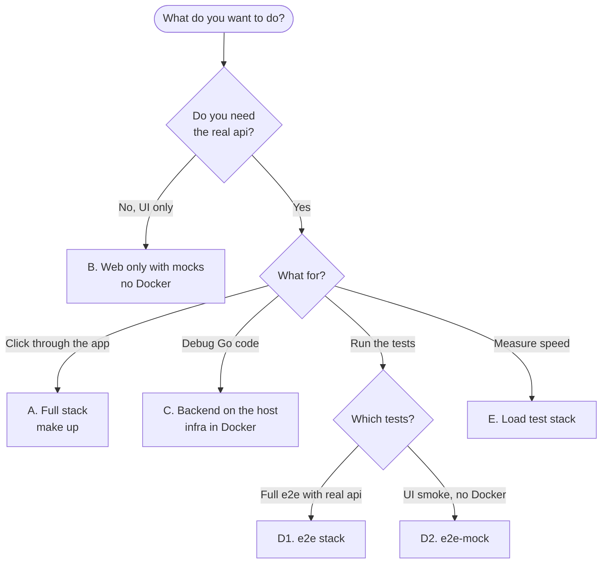
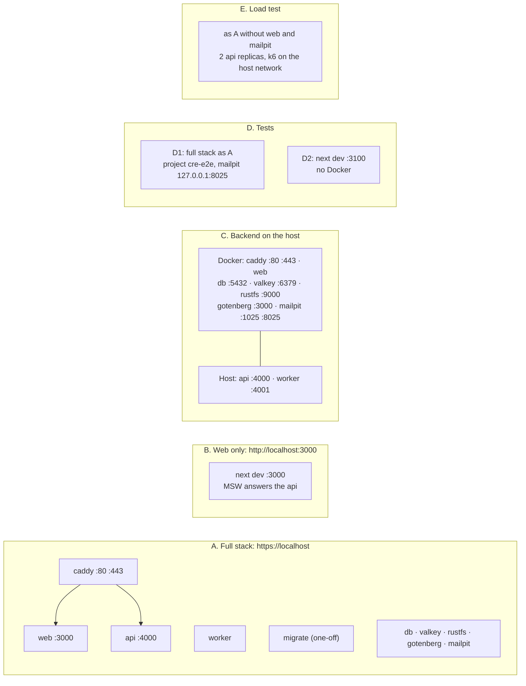

# Dev runbook: run the app on your machine

There are five ways to run CRE. Pick one, follow its steps, check it, stop it.
Production is in [deploy.md](deploy.md).

## Which way should I run it?



| Way | Use it for | Docker | Needs `.env` |
| --- | --- | --- | --- |
| [A. Full stack](#a-full-stack) | Everything, as users see it | Yes | Yes |
| [B. Web only with mocks](#b-web-only-with-mocks) | UI work | No | No |
| [C. Backend on the host](#c-backend-on-the-host) | Go debugging | Yes (infra only) | Yes |
| [D. Tests](#d-end-to-end-tests) | Playwright | D1 yes, D2 no | No |
| [E. Load test](#e-load-test) | Performance | Yes | No |

## What each way starts



Ways A, D1 and E all publish ports 80 and 443. Run one of them at a time.

## First-time setup

Do this once per machine.

1. Install Node from `.nvmrc` (24.22.3), for example with `nvm install`.
2. Turn on corepack so you get the pnpm version in `package.json`: `corepack enable`.
3. Install Go. The version is in `backend/go.mod`; Go downloads the toolchain it names.
4. Install Docker with Compose v2. Skip this if you only use way B or D2.
5. Install the packages from the repo root:

   ```sh
   corepack pnpm install --frozen-lockfile
   ```

6. Create the env file and give it a session secret (ways A, C, and the admin steps below):

   ```sh
   cp deploy/compose/.env.example deploy/compose/.env
   sed -i "s/^SESSION_SECRET=.*/SESSION_SECRET=$(openssl rand -hex 32)/" deploy/compose/.env
   ```

   On macOS use `sed -i ''`. The api does not start without `SESSION_SECRET` (32 bytes or more).
   Leave `GOOGLE_CLIENT_ID` and `GOOGLE_CLIENT_SECRET` empty: Google sign-in then answers 503.
   Never commit `.env`.

Check: `node -v` prints `v24.22.3`, `corepack pnpm -v` prints the version from `package.json`, `go version` prints Go 1.27 or newer.

## A. Full stack

Needs: Docker, ports 80 and 443 free, `deploy/compose/.env` from the setup above.

1. Start it. The first run builds the images and takes a few minutes.

   ```sh
   make up
   ```

2. Open <https://localhost> and accept the browser warning (Caddy uses its own local CA).

Check it works:

```sh
curl -k https://localhost/api/v1/healthz
docker compose -f deploy/compose/compose.yaml ps
```

All services should be `healthy` (`migrate` is `exited (0)`).

Stop it with `make down`. Data stays in Docker volumes. To start from an empty database, see [Reset the database](#reset-the-database).

### Local admin account

There is no admin sign-up. Sign up as a normal user, then promote the account.
**Never do this on a real deployment.**

1. Sign up at <https://localhost> as, for example, `admin@example.com`.
2. Read the OTP from Mailpit. It is not published on the host, so ask from inside the network.
   The code is in the `Subject` of the newest message:

   ```sh
   docker compose -f deploy/compose/compose.yaml exec caddy \
     wget -qO- http://mailpit:8025/api/v1/messages
   ```

3. Promote the account:

   ```sh
   docker compose -f deploy/compose/compose.yaml exec -T db psql -U cre_owner -d cre \
     -c "UPDATE account SET role = 'admin' WHERE email = 'admin@example.com'"
   ```

Change `cre_owner` and `cre` if you changed `POSTGRES_USER` or `POSTGRES_DB`.
The e2e suite does the same in `e2e/global-setup.ts`.
Check: sign in and open <https://localhost/admin/users>.

## B. Web only with mocks

Needs: Node and the packages only. No Docker, no `.env`, no api.
The browser and the server both answer API calls from `web/src/mocks`.

1. Start the dev server from the repo root:

   ```sh
   NEXT_PUBLIC_API_MOCKS=1 corepack pnpm --dir web dev
   ```

2. Open <http://localhost:3000>. You are signed in as a sample user.
3. For the admin area, start it with the admin role instead (an admin can open every page):

   ```sh
   NEXT_PUBLIC_API_MOCKS=1 CRE_MOCK_ROLE=admin corepack pnpm --dir web dev
   ```

   Then open <http://localhost:3000/admin/users>.

Use `-p <port>` after `dev` if port 3000 is taken.
Check: `curl -s -o /dev/null -w '%{http_code}\n' http://localhost:3000/healthz` prints `200`.
Stop it with Ctrl+C.

Mock mode skips the sign-in check, so a production build or server refuses to start with `NEXT_PUBLIC_API_MOCKS=1`.

## C. Backend on the host

Use this to run or debug the Go api and worker with your own tools.
Compose does not publish the database and the other infra (`private-net` is internal), so you add the ports with a small override file.

> [!WARNING]
> **Untested.** Nobody has run this way end to end yet (the steps were written from the compose files and the Go config code, and Docker was not available when they were written). If a step fails, fix this section and tell the team.

Needs: way A's setup, Go, ports 80, 443, 5432, 6379, 9000, 3000, 1025, 8025 and 4000 free.

1. Write the override file once. It publishes the infra on `127.0.0.1` and lets the `caddy` and `web` containers find your host api through the name `api`:

   ```sh
   cat > /tmp/cre-host.yaml <<'EOF'
   services:
     db:
       ports: ["127.0.0.1:5432:5432"]
       networks: [private-net, public-net]
     valkey:
       ports: ["127.0.0.1:6379:6379"]
       networks: [private-net, public-net]
     rustfs:
       ports: ["127.0.0.1:9000:9000"]
       networks: [private-net, public-net]
     gotenberg:
       ports: ["127.0.0.1:3000:3000"]
       networks: [private-net, public-net]
     mailpit:
       ports: ["127.0.0.1:1025:1025", "127.0.0.1:8025:8025"]
       networks: [private-net, public-net]
     caddy:
       extra_hosts: ["api:host-gateway"]
     web:
       extra_hosts: ["api:host-gateway"]
       networks: [private-net, public-net]
   EOF
   ```

2. Start the infra and the web container (not the api container), then Caddy without its dependencies:

   ```sh
   DC="docker compose -f deploy/compose/compose.yaml -f /tmp/cre-host.yaml"
   $DC up -d --build db valkey rustfs gotenberg mailpit web
   $DC up -d --no-deps caddy
   ```

3. In a shell with bash, load the env file and point it at `localhost`:

   ```sh
   set -a; . deploy/compose/.env; set +a
   export DATABASE_URL=${DATABASE_URL/@db:/@localhost:}
   export MIGRATE_DATABASE_URL=${MIGRATE_DATABASE_URL/@db:/@localhost:}
   export VALKEY_ADDR=localhost:6379 S3_ENDPOINT=http://localhost:9000
   export GOTENBERG_URL=http://localhost:3000 SMTP_HOST=localhost SMTP_PORT=1025
   ```

4. Apply the migrations and seed data. `migrate` reads `DATABASE_URL`, so give it the owner URL. It also sets the `cre_app` password from `APP_DB_PASSWORD`, which step 3 loaded from the env file:

   ```sh
   (cd backend && DATABASE_URL=$MIGRATE_DATABASE_URL go run ./cmd/migrate up)
   ```

5. Run the api. In a second shell, repeat step 3 and run the worker (needed for PDF reports and exports):

   ```sh
   cd backend && go run ./cmd/api      # shell 1
   cd backend && go run ./cmd/worker   # shell 2
   ```

Check:

```sh
curl http://localhost:4000/healthz
curl -k https://localhost/api/v1/healthz
```

Open <https://localhost> as in way A. OTP mail is at <http://localhost:8025>.

Stop it: Ctrl+C in both shells, then `$DC down`.
The host api listens on all interfaces (`HTTP_ADDR` defaults to `:4000`). If Caddy cannot reach it, check your host firewall for port 4000 from the Docker bridge.

## D. End-to-end tests

### D1. e2e stack (real api)

Needs: Docker, ports 80 and 443 free (stop way A first), Playwright's browser.
The stack has its own throw-away secrets (`e2e/compose.env`, project `cre-e2e`). It does not use your `.env`.

```sh
corepack pnpm --dir e2e exec playwright install chromium
corepack pnpm --dir e2e run stack:up
corepack pnpm --dir e2e test
corepack pnpm --dir e2e run stack:down
```

Check: `stack:up` waits until every service is healthy and returns 0; `test` prints the pass count.
`stack:down` also removes the e2e volumes.

#### OWASP ZAP scan (passive)

With the e2e stack up, run one command from the repo root. It needs Docker and `python3`, and pulls `zaproxy/zap-stable` the first time.

```sh
corepack pnpm --dir e2e run zap
```

It runs the baseline scan on the public pages, again signed in as the e2e user, and `zap-api-scan` on `contracts/openapi` in safe mode. It never attacks (no `zap-full-scan`). The HTML and JSON reports are in `e2e/zap/out/`. The command fails on any medium or high alert; `e2e/zap/rules.tsv` sets the level per rule (every IGNORE has a reason). `ZAP_AUTH=0` skips the signed-in scans. CI runs the same script nightly and on changes to the Caddyfile, `web/src/proxy.ts` or `backend/internal/http/middleware/` (job `zap` in `ci-e2e.yml`).

### D2. e2e-mock (no Docker)

Needs: Node and Playwright's browser. Playwright starts its own mock dev server (admin role) on `E2E_MOCK_PORT` (default 3100).

```sh
corepack pnpm --dir e2e exec playwright install chromium
E2E_MOCK_PORT=3100 corepack pnpm --dir e2e test:mock
```

Add `--workers=1` on a busy machine, `--project=desktop` for one viewport, or a spec path such as `mock/pages.spec.ts` for one file.
Check: the run ends with `N passed`. Playwright stops the server it started.

## E. Load test

Needs: Docker only, ports 80 and 443 free. It builds its own stack (project `cre-loadtest`) with two api replicas, and seeds 500 users, 10 projects each, 5 versions each.

```sh
loadtest/run.sh up     # build, start, seed
loadtest/run.sh test   # k6, 3 minutes (DURATION=1m for a short run)
loadtest/run.sh down   # stop, delete volumes, the locally built images (--rmi local) and the k6 image
```

Check: `up` returns 0, and `test` prints the k6 summary with every threshold passed. Results so far: [`loadtest/RESULTS.md`](../../loadtest/RESULTS.md).

## Before you push

```sh
make gen lint test
```

- `make gen` regenerates the OpenAPI bundle, Go server, sqlc code, TypeScript types and the MSW worker. Generated code is committed, and CI fails when it is stale: `git status` must show no unexpected change after it.
- `make lint` also runs `gosec` (inside golangci-lint) and `govulncheck`, so it needs network access the first time. Fix a gosec finding; for a true false positive add `//nolint:gosec // <reason>` on that line, never without a reason. govulncheck fails only on a vulnerability your code can reach: bump the module (`go get <module>@<fixed>`, `go mod tidy`) and say so in the PR.
- `make test` runs the backend tests with testcontainers, so Docker must run. Web only: `make test-web`.

## Reset the database

The database is PostgreSQL 19. Data made by an older major version (16) does not start on 19, and the `db` container keeps restarting. Reset it, which **deletes all local data**:

```sh
make down
docker volume ls | grep pgdata      # the name is <project>_pgdata, usually cre_pgdata
docker volume rm cre_pgdata
make up
```

Check: `docker compose -f deploy/compose/compose.yaml ps` shows `db` healthy and `migrate` exited with 0.
The e2e and load test stacks need no reset: their `down` removes their volumes.

## Troubleshooting

| Problem | Cause and fix |
| --- | --- |
| `port is already allocated` or `address already in use` on 80 or 443 | Another stack or web server uses the port. Find it with `ss -ltnp \| grep -E ':(80\|443) '`. Stop the other compose stack (`make down`, `e2e stack:down`, `loadtest/run.sh down`). |
| Browser warns about the certificate | Expected. Caddy signs `localhost` with its own local CA. Accept the warning once per browser. |
| Page looks stale, or Next.js shows a build error that a restart does not fix | Delete the cache and restart: `rm -rf web/.next`. |
| `api` keeps restarting, log says `SESSION_SECRET` | The secret is empty or shorter than 32 bytes. Set it in `deploy/compose/.env` (see first-time setup) and run `make up`. Check with `docker compose -f deploy/compose/compose.yaml logs api`. |
| Where is the OTP e-mail? | In Mailpit (profile `dev`, set by `COMPOSE_PROFILES=dev` in `.env`). Use the command in [Local admin account](#local-admin-account). In way C and D1 it is also at <http://localhost:8025>. |
| `no space left on device` while building | Docker images and build cache fill the disk. Check with `docker system df`, then free it with `docker builder prune` and `docker image prune`. Do not prune volumes unless you want an empty database. |
